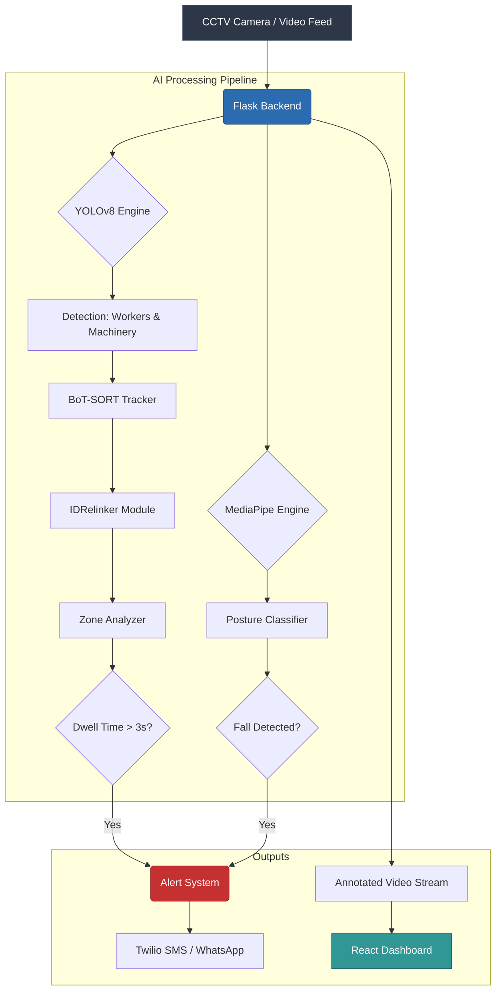

# 🚧 Safeguard AI

**Redefining construction site safety through Physical AI and smart surveillance.**

Safeguard transforms passive CCTV cameras into intelligent, proactive safety wardens. Built for the **Physical AI** track (Kaya AI Hackathon), it utilizes real-time computer vision to monitor construction sites, analyze worker interactions with their physical environment, and issue instant alerts to prevent accidents before they happen.

---

## 🏗️ System Architecture

The following diagram illustrates how video feeds are processed through our multi-threaded AI pipeline:

---

## 🎯 Problem & Inspiration

Construction sites are inherently dangerous environments. Despite strict safety protocols, human oversight is limited. Accidents involving heavy machinery, falls, and unauthorized access to hazardous zones are far too common. Safeguard acts as an automated, always-on safety officer that understands the spatial context of a construction site.

---

## 🧠 Core Features

### 1. Danger Zone Intrusion
Flags workers who linger near live machinery, crane swing radii, or excavation pits for too long. Uses a custom **ID Relinking** algorithm to maintain dwell-time continuity even through physical occlusions.

### 2. Heavy Machinery & Personnel Detection
Powered by YOLOv8 (`yolov8s.pt`), Safeguard identifies excavators, trucks, and site personnel in real-time, even in cluttered environments.

### 3. Fall & Posture Detection
Triggers emergency alerts if a worker falls from scaffolding or collapses on site, analyzing skeletal posture continuously to detect sudden vertical drops.

### 4. Real-Time Alerting
Sends instant SMS or WhatsApp notifications to site managers when critical safety thresholds are breached via Twilio integration.

### 5. Command Dashboard
A sleek, real-time React dashboard featuring a modern **"Trust Indigo & Cyber Cyan"** design system for monitoring multiple camera feeds and safety metrics simultaneously.

---

## ⚙️ Tech Stack

### Backend & AI Pipeline
- **Core:** Python 3.13, OpenCV
- **Detection & Tracking:** YOLOv8 (Ultralytics), BoT-SORT
- **Tracking Resilience:** Custom `IDRelinker` (Spatial-Temporal fallback)
- **Pose Estimation:** Google MediaPipe
- **Web Server:** Flask

### Frontend & UI
- **Framework:** React, Vite
- **Styling:** Vanilla CSS (Custom HSL-based design system)

---

## 🏗️ How It Works (Technical Breakdown)

Safeguard bridges the gap between digital models and physical safety:

1. **Multi-threaded Pipeline:** Ensures high-FPS processing by running heavy AI models (YOLO, MediaPipe) on dedicated threads alongside asynchronous video I/O.
2. **YOLOv8 & Tracking:** Pinpoints human coordinates relative to mapped danger polygons using the BoT-SORT tracker algorithm.
3. **ID Relinker:** A robust post-processing layer that stitches broken tracker IDs together based on a 100px / 2.0s spatial-temporal window. This prevents false resets of danger-zone dwell timers when workers momentarily cross paths or are occluded.
4. **Posture Analysis:** MediaPipe tracks 33 skeletal landmarks per worker to calculate vertical velocity and angle, instantly detecting sudden drops indicative of a fall.

---

## 🧩 Overcoming Challenges

- **Tracker ID Instability (The Occlusion Problem):** In crowded construction sites or low-light conditions, workers constantly occlude each other, causing standard object trackers to lose IDs and reset dwell timers. We built a custom `IDRelinker` module that protects the critical "dwell-timer" by temporarily storing "ghost tracks" and re-associating them when the worker re-appears.
- **Real-World Clutter:** Differentiating workers from heavy machinery in chaotic, dusty construction footage required careful confidence thresholding and dedicated spatial zone definitions.

---

> *"A smarter site isn’t just productive — it’s physically aware."*
