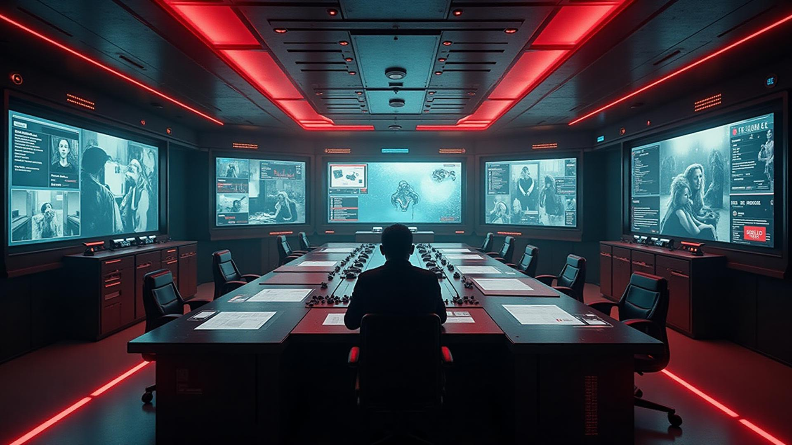

  <h1>🚧 Safeguard AI 🚧</h1>
  <h3><em>Redefining construction site safety through Physical AI and smart surveillance.</em></h3>

<!-- Terminal Intro Animation -->

  

## 🎯 Problem & Inspiration

<table>
<tr>
<td>

Construction sites are inherently dangerous environments. Despite strict safety protocols, human oversight is limited, and accidents involving heavy machinery, falls, and unauthorized access to hazardous zones are far too common.

Built for the **Kaya AI "Physical AI" Track**, **Safeguard** transforms passive CCTV cameras into intelligent, proactive safety wardens. By utilizing real-time computer vision, Safeguard monitors construction sites, analyzes worker interactions with their physical environment, and issues instant alerts to prevent accidents before they happen.

</td>
<td width="40%">

</td>
</tr>
</table>

## 🧠 What It Does (Physical AI Features)

  <table>
    <tr>
      <td align="center"><h3>🏗️</h3><h4>Danger Zone Intrusion</h4>
Flags workers lingering near live machinery, crane swing radii, or excavation pits.
</td>
      <td align="center"><h3>🎯</h3><h4>YOLOv8 Detection</h4>
Identifies heavy machinery, excavators, and site personnel in real-time.
</td>
    </tr>
    <tr>
      <td align="center"><h3>🤕</h3><h4>Fall & Posture Detection</h4>
Triggers emergency alerts if a worker falls from scaffolding or collapses on site.
</td>
      <td align="center"><h3>🔍</h3><h4>Real-Time Alerts</h4>
Instant SMS/WhatsApp notifications to site managers via Twilio & PyWhatKit.
</td>
    </tr>
    <tr>
      <td align="center"><h3>👁️</h3><h4>Worker Tracking</h4>
Assigns unique IDs to track movement through active hazard zones.
</td>
      <td align="center"><h3>🌐</h3><h4>Command Dashboard</h4>
A sleek, Cyber Cyan & Indigo React dashboard for monitoring multiple feeds.
</td>
    </tr>
  </table>

## ⚙️ Tech Stack

🐍 Python • 📹 OpenCV • 🧠 YOLOv8 • 🖐️ MediaPipe • 🌐 Flask Backend  
⚛️ React & Vite • 🌊 Tailwind CSS • 💬 Twilio • 🔥 Firebase • 🐘 PostgreSQL

## 👷 Target Users

- 🏗️ **Site Managers & Foremen** – Looking to maintain 24/7 safety oversight without manual patrolling.
- 🦺 **Safety Officers (HSE)** – Needing automated logging of safety violations (e.g., restricted zone intrusions).
- 🏢 **Construction Firms** – Aiming to lower insurance premiums and achieve zero-harm work environments.

## 🏗️ How We Built It

<table>
<tr>
<td>

Safeguard bridges the gap between digital models and physical safety:

- 🧵 **Multi-threaded Pipeline**: Ensures high-FPS processing of heavy AI models alongside video I/O.
- 🧠 **YOLOv8 & Centroid Tracking**: Pinpoints human coordinates relative to mapped danger polygons.
- 🖐️ **MediaPipe integration**: Tracks worker posture for critical health emergencies (falls/collapses).
- 🌐 **Modern React Frontend**: HMR-enabled Vite dashboards styled with a premium Indigo & Cyber Cyan glassmorphism aesthetic.

</td>
<td width="40%">

</td>
</tr>
</table>

## 🧠 What We Learned

- Designing robust Physical AI pipelines that map 2D video coordinates to physical danger zones.
- Overcoming legacy dependency issues (e.g., dynamically handling legacy MediaPipe APIs on Python 3.13).
- Crafting premium, hardware-accelerated frontend UI architectures using React and Tailwind CSS.
- Reducing alert fatigue by tuning dwell-time thresholds for danger zones.

---

## 🧩 Challenges Faced

- ⚠️ **Dynamic Tracking:** Handling bounding-box flickering where the tracker would assign new IDs to workers, prematurely resetting their dwell-time in danger zones.
- 🔍 **Real-World Clutter:** Differentiating workers from heavy machinery in chaotic, dusty construction footage.
- 💾 **System Overhead:** Managing the memory footprint of YOLOv8 alongside pose estimation on standard hardware.

> 🔐 *“A smarter site isn’t just productive — it’s physically aware.”*

  Built for the Kaya AI Hackathon

