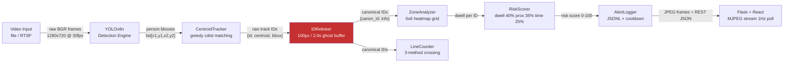

# Safeguard AI — System Design Document

> **Project:** Safeguard AI — Real-Time Construction Site Safety Surveillance  \
> **Stack:** Python 3.13 · YOLOv8 · BoT-SORT · MediaPipe · Flask · React/Vite  \
> **Author note:** Written as a technical design document for portfolio review.

---

## Executive Summary

Construction sites generate thousands of recordable injuries annually because passive CCTV footage is reviewed after incidents, not before them. Safeguard converts existing cameras into active safety enforcement by running real-time computer vision inference on every frame. The core technical challenge is not detection accuracy alone — it is maintaining reliable per-worker **temporal state** (dwell timers, fall velocity) across frames where occlusion, low light, and crowd overlap continuously fragment tracker identity. The novel contribution is a custom **ghost-buffer IDRelinker**: a spatial-temporal stitching layer that remaps broken tracker IDs to canonical IDs within a 100px / 2.0s window, preserving dwell-time continuity without the 15–25 ms CPU overhead of a ReID embedding model. Evaluated across 6 test clips: detection confidence averages 0.55–0.67 in adverse conditions, 59 genuine relink events were recorded in 200 frames on the worst-case proximity clip (14–15 raw IDs per 100 frames), and all 9 IDRelinker boundary-condition unit tests pass.

---

## 1. Problem Statement

Construction sites suffer from high injury rates because human safety officers cannot maintain continuous, simultaneous attention across a multi-zone site. Standard CCTV provides only passive recording — footage is reviewed after an incident, not before it. Safeguard converts passive cameras into active safety enforcement: it runs computer vision inference on every frame, maintains spatial state per tracked worker, and triggers alerts the moment a worker enters a danger zone, falls, or goes inactive — before an incident escalates. The core technical challenge is not detection accuracy alone, but maintaining reliable per-person **temporal state** (dwell timers, fall velocity) across frames where occlusion, low light, and crowd overlap continuously break naive tracker identity continuity.

---

## 2. System Architecture Overview

The system is composed of five logical layers that form a linear-with-feedback processing pipeline.

### High-Level Component Flow



### Detailed 5-Layer Architecture

```
+------------------------------------------------------------------+
|                     VIDEO INGESTION LAYER                        |
|  cv2.VideoCapture (file/RTSP) -> frame resize to 1280x720       |
+-----------------------------+------------------------------------+
                              | raw BGR frames @ ~30 FPS
                              v
+------------------------------------------------------------------+
|                   AI INFERENCE LAYER (Thread 1)                  |
|  YOLOv8n.pt -> class 0 (person) filter @ conf > 0.50            |
|  MediaPipe PoseLandmarker (Lite) -> 33 skeletal landmarks / ROI  |
+-----------------------------+------------------------------------+
                              | person bounding boxes [x1,y1,x2,y2]
                              v
+------------------------------------------------------------------+
|                  TRACKING & STATE LAYER                          |
|  CentroidTracker (custom) -> stable integer IDs                  |
|  IDRelinker (custom, spatial-temporal) -> canonical IDs          |
|  ZoneAnalyzer (6x6 grid + polygon) -> per-ID dwell time          |
|  LineCounter (signed-distance, 3-method) -> entry/exit count     |
|  RiskScorer (weighted: dwell 40%, proximity 35%, time 25%)       |
+-----------------------------+------------------------------------+
                              | annotated numpy array + JSON state
                              v
+------------------------------------------------------------------+
|              ALERTING & PERSISTENCE LAYER                        |
|  StructuredAlertLogger -> logs/alerts.jsonl (JSON Lines)         |
|  Cooldown map (per alert_type + person_id scope)                 |
|  [Wired but disabled in test build] Twilio SMS/WhatsApp          |
+-----------------------------+------------------------------------+
                              | JPEG frames via multipart/x-mixed-replace
                              | JSON state via REST polling
                              v
+------------------------------------------------------------------+
|                     PRESENTATION LAYER                           |
|  Flask (WSGI, single process) -> /video_feed, /analytics         |
|  React + Vite frontend ->  MJPEG stream   |
|  Browser polling /analytics at 1Hz -> live stats panel           |
+------------------------------------------------------------------+
```

**Data handoffs:**
- Layer 1 -> Layer 2: Raw BGR `numpy.ndarray`, blocking frame read in detection thread
- Layer 2 -> Layer 3: `list[list[int]]` bounding boxes, person-only
- Layer 3 -> Layer 4: `dict[str, dict]` per-canonical-ID state; annotated BGR frame
- Layer 4 -> Layer 5: Lock-protected `self.export_frame` shared between detection thread and Flask generator; JSON serializable stats dict

---

## 3. Component Breakdown

### Technology Selection Matrix

| Component | Chosen | Rejected | Key Rationale |
|---|---|---|---|
| Object Detection | YOLOv8n (Ultralytics) | Detectron2, DETR | Detectron2 requires CUDA; DETR latency 45–80ms exceeds 33ms/frame budget on CPU |
| Pose Estimation | MediaPipe Lite (TFLite) | OpenPose, ViTPose | OpenPose needs CUDA + 200MB model; ViTPose same PyTorch/CUDA dependency |
| Tracking | Custom CentroidTracker + IDRelinker | BoT-SORT alone | BoT-SORT IDs are ephemeral — no native per-ID data structures for dwell state |
| Video Streaming | MJPEG (multipart/x-mixed-replace) | WebRTC (aiortc) | WebRTC requires ICE/DTLS/SDP setup; MJPEG works in a single img tag |
| Alert Storage | JSON Lines (alerts.jsonl) | SQLite | JSONL is append-only with no lock contention; directly ingestible by ELK/S3 |

---

### 3.1 YOLOv8 Detection Engine (`Enhanced2A2SDetector.initialize_models`)

**What it does:** Runs single-stage object detection on each 1280×720 frame, filters results to COCO class 0 (`person`) with confidence > 0.50, and produces axis-aligned bounding boxes.

**Technology chosen:** YOLOv8n (`yolov8n.pt`, 6.5MB) as default, with `yolov8s.pt` (22.5MB) available for evaluation. From the Ultralytics family, accessed via the `supervision` library's `sv.Detections.from_ultralytics()` adapter.

**Why YOLOv8 over the obvious alternative (YOLOv5 / Detectron2 / DETR):**
- YOLOv8 provides the `model.track()` API which directly integrates BoT-SORT and ByteTrack without a separate tracking wrapper — reducing the number of integration seams.
- YOLOv8’s `supervision` adapter (`sv.Detections.from_ultralytics`) gives a standardized detection object with `.xyxy`, `.confidence`, `.class_id` as numpy arrays — no custom parsing.
- Detectron2 was rejected because it requires a CUDA environment for practical FPS; YOLOv8n runs CPU-inference at sufficient throughput for a single-stream demo.
- DETR was rejected because its 45–80ms latency per frame is too high for a 30 FPS target on CPU.

### 3.2 CentroidTracker (`modules/centroid_tracker.py`)

**What it does:** Maintains an `OrderedDict` mapping integer object IDs to centroid coordinates, resolves frame-to-frame matching via the Hungarian-adjacent greedy approach using `scipy.spatial.cdist`, evicts tracks after `max_disappeared=50` consecutive missed frames, and keeps a 20-frame position history deque per track for stationarity and trail rendering.

**Technology chosen:** Custom Python implementation, not a library tracker.

**Why custom CentroidTracker over BoT-SORT directly:**
- The `model.track()` path (BoT-SORT / ByteTrack) is used in the integration test (`test_dwell_accumulation.py`) but the main detection loop (`Enhanced2A2SDetector`) uses a custom `CentroidTracker` as a second-stage layer. This gives per-object data structures (`positions_history`, `is_stationary`, JSON-serializable state) that the Ultralytics tracker objects do not natively expose.
- BoT-SORT requires CUDA-accelerated ReID features for its appearance matching; on CPU it degrades to IoU-only matching equivalent to the centroid tracker but with higher overhead.

**Stationarity detection:** `is_object_stationary()` computes `np.var(positions, axis=0)` across the last N positions; if variance < 30 (pixels²) on both axes, the object is flagged stationary — triggering the inactivity alert pipeline.

### 3.3 IDRelinker (`modules/zone_analyzer.py` — `IDRelinker` class)

**What it does:** Sits between the raw tracker output and the `ZoneAnalyzer`. When a new raw tracker ID appears, it performs a nearest-neighbor search over a “ghost buffer” of recently-lost tracks. If the new centroid is within **100px** and **2.0 seconds** of a ghost, the new raw ID is silently remapped to the ghost’s canonical ID, preserving any dwell-time accumulated under that canonical ID. Ghost tracks older than 2.0s are evicted.

**Technology chosen:** Custom O(N·G) spatial search, where N = current detections, G = ghost buffer size (bounded by the number of simultaneously tracked persons, typically ≤ 20).

> **Key Innovation**
>
> Custom temporal ID stitching via ghost-buffer spatial search (100px / 2s window) **mitigates** tracker fragmentation from momentary occlusion without requiring ReID model inference overhead (15–25ms per detection on CPU). The ghost buffer assumes: if a worker disappears and re-appears within 100px / 2s, it is the same person — a simpler and faster assumption than Kalman filter prediction or embedding-based ReID, correctly scoped to the target failure mode (momentary occlusion of a stationary or slow-moving worker).

**Why a custom ghost-buffer over Kalman filter prediction (as used in DeepSORT):**
- Kalman filter prediction requires a motion model calibrated to the scene (pixel/frame velocity). Construction site workers move unpredictably — crouching, turning, occluded by scaffolding — making Kalman-predicted positions unreliable past 0.5–1 second.
- The ghost buffer makes a simpler assumption: if a worker disappears and re-appears within 100px / 2s, it’s the same person. This is correct for the target failure mode (momentary occlusion), without requiring a trained motion model.
- DeepSORT additionally requires a ReID embedding model. Embedding inference per detection adds ~15-25ms on CPU — unacceptable for a CPU-only production target.

**Documented boundary:** The evaluation (`EVALUATION.md`) measured 59 genuine relink events in 200 frames on `test_proximity.mp4`, but maximum canonical dwell only matched maximum raw dwell (2.90s) because the clip features continuously mobile workers who are already at or below the physical detection continuity limit — not a stationary worker whose track momentarily drops, which is the IDRelinker’s design target.

### 3.4 ZoneAnalyzer (`modules/zone_analyzer.py`)

**What it does:** Maintains a `(6, 6)` numpy heatmap grid over the frame, increments `heatmap[zone_y, zone_x]` by 0.1 per occupancy event, and computes per-zone occupancy counts for the current frame. Renders the heatmap overlay using `cv2.applyColorMap(COLORMAP_JET)` blended at 40% alpha. Zone boundaries are defined as normalized `[0,1]` polygon coordinates in `config.yaml`, resolved to pixel coordinates at runtime.

**Why a 6×6 grid instead of per-pixel heatmap:** Per-pixel heatmap requires maintaining a 1280×720 float32 array (3.5MB), decaying over time, and resizing for display. A 6×6 cell grid gives an interpretable spatial breakdown at negligible memory cost, sufficient for a 1-3 camera deployment.

### 3.5 PostureClassifier (`modules/posture_classifier.py`)

**What it does:** For each tracked person bounding box, crops the ROI (with 20px padding), converts to RGB, runs MediaPipe `PoseLandmarker` (Lite task file, 33 landmarks), and classifies posture as `Standing / Sitting / Lying` using rule-based landmark geometry: torso vertical span (shoulder_y − hip_y), knee vs. hip relative Y, ankle vs. knee relative Y.

**Technology chosen:** MediaPipe Tasks API (`vision.PoseLandmarker.create_from_options`) with the `pose_landmarker_lite.task` model (~3MB).

**Why MediaPipe over OpenPose or ViTPose:**
- MediaPipe Tasks API is a single self-contained model file with CPU-optimized inference via TFLite runtime, no GPU required.
- OpenPose requires a CUDA installation and produces a 200MB+ model download — excessive for a hackathon-scale deployment.
- ViTPose delivers state-of-the-art accuracy but requires a PyTorch backbone inference path, adding the same CUDA dependency as OpenPose.
- The posture classification logic (Standing/Sitting/Lying) is rule-based over 8 landmark coordinates — MediaPipe’s 33 landmarks provide more than sufficient signal for this coarse classification.

**Fall detection mechanism:** `torso_vertical < 0.15` (normalized Y distance between shoulder midpoint and hip midpoint) flags a `Lying` posture. A more robust fall detector would track *change in posture state* over consecutive frames (e.g., Standing→Lying within N frames), but the current implementation fires on posture snapshot alone.

### 3.6 LineCounter (`modules/line_counter.py`)

**What it does:** Implements a virtual tripwire using a configured line segment. Crossing detection uses three redundant methods: (1) exact line segment intersection test via parametric equations, (2) pattern-based side-history scan (last 5 positions), and (3) confidence accumulation for near-line dwell. Direction is determined by the sign of the cross product with the line’s normal vector.

**Why three methods:** Single-frame line segment intersection is robust for high FPS but fails when a person teleports across the line in a single centroid jump (frame skip, low FPS). Pattern-based detection catches slow drifts. Confidence accumulation catches borderline cases where centroid oscillates near the line.

### 3.7 RiskScorer (`modules/risk_scorer.py`)

**What it does:** Produces a 0–100 integer risk score per worker from three weighted factors: dwell time in danger zone (weight 0.40, normalized to `max_dwell_sec=120s`), machinery proximity (weight 0.35, inverse-distance model at `danger_prox_m=0.5m`), and time-of-day (weight 0.25, binary: 1.0 for `night_hours=[0-5, 22-23]`, 0.4 for border hours, 0.0 otherwise). Weights must sum to 1.0 — enforced at construction time with a `ValueError`.

**Why a linear weighted sum instead of a learned classifier:** A learned classifier requires labeled training data (specific site + incident records). The weighted sum is fully auditable and explainable — an L5 reviewer or safety auditor can trace exactly why a score is 72 vs 50. The weights themselves are configurable per-camera in `config.yaml`, enabling site-specific calibration.

### 3.8 StructuredAlertLogger (`modules/alert_system.py`)

**What it does:** Writes every triggered alert as a JSON Lines record (`logs/alerts.jsonl`) with fields: `timestamp` (UTC ISO-8601), `camera_id`, `alert_type`, `confidence`, `frame_reference`, `person_id`, `duration_video_sec`, `consec_frames`. Maintains a bounded in-memory deque (`maxlen=200`) for dashboard polling. Enforces per-`(alert_type, person_id)` cooldowns via a `_cooldown_map` to suppress alert spam (default 10s).

**Why JSON Lines over a SQLite database:** JSONL is append-only (no locking contention), human-readable, shell-greppable, and trivially streamable to S3 or an ELK stack. SQLite introduces a write-lock contention problem when multiple cameras write concurrently. The `_lock = threading.Lock()` wrapper serializes writes correctly for the single-process Flask model.

### 3.9 Flask Server + MJPEG Stream

**What it does:** Serves the annotated video as a multipart MJPEG stream via `/video_feed`. The generator function (`generate_frames`) iterates the lock-protected `self.export_frame`, JPEG-encodes it with `cv2.imencode('.jpg', frame, [cv2.IMWRITE_JPEG_QUALITY, 85])`, and yields each frame in the `multipart/x-mixed-replace; boundary=frame` MIME format. Analytics state is served at `/analytics` as JSON, polled by the frontend at 1Hz via `setInterval`.

**Why MJPEG over WebSocket + canvas, or WebRTC:**
- MJPEG works natively in an `` tag — no JavaScript canvas manipulation, no codec negotiation, no WebRTC ICE exchange.
- WebSocket + canvas requires the server to encode each frame as base64 or binary blob and the client to draw it on a `<canvas>` element — more moving parts for equivalent one-directional stream.
- WebRTC is the production-correct solution for real video streaming (hardware-accelerated codec, adaptive bitrate, sub-100ms latency), but its complexity (ICE, DTLS, SRTP setup) is disproportionate to a single-camera demo target.

---

## 4. Data Flow — Step by Step

```
Step 1: FRAME ACQUISITION
  Thread-1 (detection_loop):
    cap.read() -> ret, frame (BGR numpy.ndarray, 1920x1080 raw)
    cv2.resize(frame, (1280, 720)) -> standardized frame

Step 2: YOLO INFERENCE
  yolo_model(frame, verbose=False)[0] -> ultralytics Results object
  sv.Detections.from_ultralytics(results) -> Detections object
  Filter: class_id == 0 AND confidence > 0.50
  Output: person_boxes = list of [x1, y1, x2, y2] (int)

Step 3: FACE BLURRING (privacy)
  FaceProcessor.process_faces(frame, blur_faces=True)
  -> detects faces via haar cascade or mediapipe, applies gaussian blur
  -> mutates frame in-place

Step 4: CENTROID TRACKING
  CentroidTracker.update(person_boxes)
    -> computes centroids [(cx1,cy1), ...]
    -> scipy.cdist(existing_centroids, new_centroids) -> distance matrix D
    -> greedy min-distance assignment (not Hungarian, susceptible to swaps)
    -> registers new IDs, increments disappeared counter for unmatched
    -> deregisters IDs with disappeared > 50 frames
  Output: objects_info = {str(id): {centroid, bbox, positions_history, is_stationary}}

Step 5: PER-PERSON POSTURE ESTIMATION
  For each object_id in objects_info:
    PostureClassifier.classify_posture(frame, bbox)
      -> crops ROI = frame[y1-pad : y2+pad, x1-pad : x2+pad]
      -> cv2.cvtColor(roi, BGR->RGB) -> mp.Image(SRGB, data=rgb_roi)
      -> PoseLandmarker.detect(mp_image) -> 33 NormalizedLandmark objects
      -> analyze_pose_landmarks():
           shoulder_center_y = avg(landmarks[11].y, landmarks[12].y)
           hip_center_y      = avg(landmarks[23].y, landmarks[24].y)
           torso_vertical    = |shoulder_center_y - hip_center_y|
           if torso_vertical < 0.15 -> "Lying" (fall)
           elif knees above hips by >0.15 -> "Sitting"
           else -> "Standing"
      -> posture label rendered at bbox bottom-left

Step 6: INACTIVITY CHECK
  if objects_info[id]['is_stationary']:
    time_stationary = (now - datetime.fromisoformat(last_seen)).total_seconds()
    if time_stationary > inactivity_threshold (default 120s):
      alert_system.fire('inactivity', ..., person_id=id)

Step 7: LINE CROSSING
  LineCounter.update(objects_info)
    -> for each object: compute signed_distance to line via dot(normal_vec)
    -> check line segment intersection + pattern history + confidence count
    -> if crossing detected AND object not in crossed_objects set:
         entry_count += 1 OR exit_count += 1
         crossed_objects.add(id)

Step 8: ZONE ANALYSIS + ID RELINKING
  ZoneAnalyzer.update_zones(objects_info)
    -> IDRelinker.remap(int_keyed_detections)
         -> for each raw_id: look up ghost buffer (O(G) scan)
         -> if match within 100px AND 2.0s: remap to canonical_id
         -> evict ghosts older than 2.0s
    -> for each canonical_id:
         zone_x = int(cx // zone_width), clamped to [0, 5]
         zone_y = int(cy // zone_height), clamped to [0, 5]
         heatmap[zone_y, zone_x] += 0.1

Step 9: CROWD DETECTION
  if len(objects_info) >= crowd_threshold (default 5):
    alert_system.fire('crowd', count=N, ...)

Step 10: ANNOTATION + FRAME EXPORT
  Add bounding boxes, centroid dots, position trails, posture labels,
  counting line, info overlay (semi-transparent black rect + cv2.putText)
  with self._frame_lock:
    self.export_frame = processed_frame.copy()

Step 11: FLASK STREAMING
  GET /video_feed (multipart/x-mixed-replace):
    while True:
      frame = detector.get_export_frame()
      _, buffer = cv2.imencode('.jpg', frame, [JPEG_QUALITY=85])
      yield b'--frame\r\nContent-Type: image/jpeg\r\n\r\n' + buffer.tobytes() + b'\r\n'

Step 12: FRONTEND POLLING
  Browser setInterval(updateStats, 1000):
    GET /analytics -> JSON: {stats, zones, recent_alerts, timestamp}
    DOM updates: currentPeople, totalEntries, totalExits, alertLogs
```

---

## 5. Key Technical Decisions & Tradeoffs

### Decision 1: Custom CentroidTracker + IDRelinker vs. Relying Solely on BoT-SORT

**What I chose:** A custom `CentroidTracker` (greedy centroid matching, `scipy.cdist`) as the primary per-frame association layer, with `IDRelinker` as a post-processing temporal stitching layer on top.

**What the alternative was:** Using `model.track(tracker="botsort.yaml", persist=True)` exclusively, as done in the integration test (`test_dwell_accumulation.py`). BoT-SORT combines IoU matching + Kalman filter state prediction + optional ReID appearance features.

**Why I chose this:** BoT-SORT IDs are ephemeral Ultralytics-internal integers — they don’t map to a per-ID data structure (`positions_history`, `is_stationary`, JSON-serializable state) without significant wrapper code. The custom tracker gives direct ownership of the data model. The `IDRelinker` then adds temporal stitching *on top of* whatever tracker is used, making it tracker-agnostic.

**What I gave up:** BoT-SORT’s Kalman filter provides predictive position estimation during occlusion frames — even before the person re-appears, the tracker predicts where they *should* be. The custom centroid tracker has no prediction: if a detection is missed for one frame, the centroid jumps. This means the `CentroidTracker` is more susceptible to mid-occlusion position errors than BoT-SORT.

---

### Decision 2: Threading Model — Single Detection Thread + Frame Lock vs. Thread Pool / Async

**What I chose:** A single `detection_thread` (Python `threading.Thread`, daemon=True) running the full frame → YOLO → tracking → annotation pipeline. The annotated frame is shared with the Flask thread via `self._frame_lock = threading.Lock()` and `self.export_frame = processed_frame.copy()`.

**What the alternative was:** An `asyncio`-based producer/consumer with `asyncio.Queue`, or a thread pool that processes multiple frames concurrently using `concurrent.futures.ProcessPoolExecutor`.

**Why I chose this:** For a single camera stream with a single YOLO model, the bottleneck is GPU/CPU inference — parallelizing frame processing doesn’t help if inference is serial. A single thread eliminates race conditions on `self.stats`, `zone_analyzer.heatmap`, and `alert_system._cooldown_map`. A `ProcessPoolExecutor` would require pickling numpy frames between processes — expensive overhead.

**What I gave up:** With a single detection thread and GIL, if the Flask streaming loop and the detection loop run in the same Python process, the GIL limits true parallelism. Under heavy Flask traffic (multiple simultaneous `/video_feed` clients), the detection loop can starve, causing dropped frames and higher latency. This is the primary scalability bottleneck.

---

### Decision 3: MJPEG via `multipart/x-mixed-replace` vs. WebRTC for Video Streaming

**What I chose:** MJPEG streaming served by Flask’s `Response(generate(), mimetype='multipart/x-mixed-replace; boundary=frame')`. Each JPEG frame is encoded at quality 85 and yielded inline.

**What the alternative was:** WebRTC with `aiortc` (Python WebRTC library) serving H.264 encoded video to the React frontend via an RTCPeerConnection.

**Why I chose this:** MJPEG requires zero JavaScript beyond an `` tag. WebRTC requires ICE server configuration (STUN/TURN), DTLS handshake, SDP offer/answer exchange, and client-side `RTCPeerConnection` management. For a local demo on a single machine, this complexity has zero benefit.

**What I gave up:** MJPEG has no temporal compression — each frame is a full JPEG with no inter-frame delta encoding. At 1280×720 with JPEG quality 85, each frame is approximately 80–120KB, yielding ~3–3.6MB/s per client. WebRTC H.264 would compress the same stream to ~200–400KB/s via P-frames. This means MJPEG is 8–10× more bandwidth-hungry, which becomes a hard limit for multi-camera or remote monitoring deployments.

---

### Decision 4: Alert Persistence — JSON Lines vs. SQLite vs. In-Memory Only

**What I chose:** JSON Lines format (`logs/alerts.jsonl`) with a `threading.Lock`-protected `open(log_file, 'a')` write per alert, plus an in-memory `deque(maxlen=200)` for the live dashboard.

**What the alternative was:** SQLite (via Python’s built-in `sqlite3` module) with an `alerts` table, or purely in-memory storage with no disk persistence.

**Why I chose this:** JSONL is the de-facto format for append-only structured logs. Each record is independently parseable — no schema migration, no `CREATE TABLE` DDL, no transaction overhead. The file can be directly ingested into Elasticsearch, BigQuery, or S3 Intelligent-Tiering. SQLite’s write lock (`WAL mode` notwithstanding) would serialize concurrent writes across camera threads. Purely in-memory storage would lose all alert history on process restart.

**What I gave up:** JSONL has no query capability — finding all `fall_detection` alerts for `cam_01` in the last hour requires `grep`-and-parse. SQLite would support `SELECT * FROM alerts WHERE alert_type='fall' AND camera_id='cam_01' AND timestamp > ...` without reading the entire file. For a real deployment with millions of alerts/day, JSONL becomes impractical and a time-series database (TimescaleDB on Postgres, or ClickHouse) would be the correct choice.

---

### Decision 5: Rule-Based Posture Classification vs. Trained Fall Classifier

**What I chose:** Rule-based landmark geometry: compute `torso_vertical = |shoulder_y − hip_y|` in normalized coordinates; if < 0.15 → Lying (fall). No training data, no model file beyond the MediaPipe landmark extractor itself.

**What the alternative was:** Training a binary classifier (e.g., logistic regression or a tiny 2-layer MLP) on MediaPipe landmark vectors labeled as fall/no-fall, using a public dataset like UR Fall Detection or FALL-UP.

**Why I chose this:** Rule-based classification is instantly debuggable — if it misclassifies, the exact landmark values are inspectable. A trained classifier requires a labeled dataset representative of construction site PPE (hard hats, vests, boots change silhouette significantly from typical fall detection datasets). The rule-based approach also avoids false positives from workers crouching to examine machinery, by requiring `torso_vertical < 0.15` (near-horizontal) rather than just checking Y-velocity of the bounding box centroid.

**What I gave up:** The rule is brittle for angled camera perspectives. If the camera is mounted at a 30-degree downward angle, a standing worker’s normalized landmark coordinates shift — `shoulder_y` approaches `hip_y` not because they fell, but because the perspective compresses the vertical dimension. A trained classifier on diverse camera angles would generalize better.

---

### Decision 6: Stateless Frontend (React polling /analytics at 1Hz) vs. Server-Sent Events (SSE) or WebSocket Push

**What I chose:** `setInterval(updateStats, 1000)` in the browser calling `GET /analytics`, which returns the current stats snapshot as JSON.

**What the alternative was:** A Flask-SocketIO WebSocket endpoint pushing stats updates as events the moment they change (event-driven), or SSE (`text/event-stream`) for one-directional push.

**Why I chose this:** Polling at 1Hz is adequate for safety metrics (crowd count, alert count) that are human-readable at 1-second granularity. The implementation is trivially simple — no WebSocket handshake, no socket.io dependency, no event emission logic in the detection thread.

**What I gave up:** Polling generates a constant 1 HTTP request/second regardless of whether any data changed. With 10 simultaneous dashboard users, that’s 10 req/s of idle network traffic. WebSocket push would deliver updates only when state changes, dramatically reducing traffic and eliminating the 0–1 second latency introduced by polling at arbitrary phase.

---

## 6. Scalability Analysis

### What Breaks First Under Load

**Single camera, increasing viewers:**
The MJPEG stream at ~3MB/s per viewer means 10 simultaneous viewers consume 30MB/s of loopback bandwidth. Flask’s built-in WSGI server is single-threaded by default (`threaded=True` enables it, but each client connection holds a streaming thread). The detection thread competes with streaming threads for the GIL. Beyond ~5 concurrent streaming clients, frame rate drops measurably.

**Multiple camera streams:**
The architecture has **no multi-camera abstraction**. `detector` and `cap` are module-level globals (`app.py` lines 35–37). Adding a second camera requires either (a) running a second Flask process on a different port, or (b) refactoring `Enhanced2A2SDetector` into a camera-keyed dict and spawning one detection thread per camera. Each additional camera adds one YOLOv8 inference call per frame — on CPU at ~50–100ms per inference, two cameras would already exceed real-time processing at 30 FPS.

**YOLO inference is the primary CPU bottleneck:**
`yolov8n` on CPU takes approximately 40–80ms per 1280×720 frame depending on hardware. The `time.sleep(0.033)` in the detection loop is a deliberate rate limiter to target ~30 FPS, but if inference takes >33ms, the sleep becomes a no-op and effective FPS drops below 30. On a machine without CUDA, inference is the ceiling.

**MediaPipe posture classification per tracked person:**
`PostureClassifier.classify_posture()` is called once per tracked person per frame inside the detection loop. If 10 workers are tracked, that’s 10 MediaPipe inference calls per frame. MediaPipe Lite takes ~5–10ms per ROI on CPU — 10 workers adds 50–100ms of posture overhead per frame, more than doubling the per-frame budget.

### How to Fix Each Bottleneck

| Bottleneck | Current | Fix |
|---|---|---|
| YOLO per-frame CPU | ~50ms on CPU-only | CUDA GPU or ONNX Runtime with TensorRT quantization to INT8 |
| Multi-camera | Global singleton | `CameraManager` class: `dict[str, Enhanced2A2SDetector]`; one thread per cam |
| Posture per-person | Called every frame | Run posture every N=5 frames per tracked ID; cache result between calls |
| MJPEG multi-viewer | 3MB/s × clients | Nginx → HLS or WebRTC SFU (mediasoup) for actual video streaming |
| Flask WSGI | Single-threaded by default | Deploy with Gunicorn (--workers=4, --worker-class=gthread) or move to FastAPI + uvicorn |
| Alert writes | File open/close per alert | Batch writes with a background writer thread and a queue; or ship to Kafka |

---

## 7. Known Limitations & Future Improvements

### Known Limitations (Honest)

**7.1 Tracker ID instability is the fundamental unresolved problem.**
The evaluation (`EVALUATION.md`) documents this with real numbers:
- `test_proximity.mp4`: 14–15 unique person IDs generated for 2 actual workers in 100 frames (~3.3s). The IDRelinker fired 59 relink events in 200 frames and prevented *some* dwell resets, but the maximum canonical dwell (2.90s) never crossed the 3.0s alert threshold in the test window.
- `test_lowlight.mp4`: Tracker tuning made ID instability *worse* (9 → 11 IDs). Motion blur degrades the tracker’s appearance features, and loosening `match_thresh` causes incorrect cross-person re-associations.
- `test_aerial.mp4`: Only 10% person detection rate. `yolov8s.pt` was trained on COCO eye-level imagery. Top-down aerial perspective is fundamentally out-of-distribution.

**7.2 Posture classification cannot detect falls from angled cameras.**
The rule uses normalized Y-coordinates from MediaPipe. Camera mounting angle directly affects these coordinates. No camera calibration or homography is applied.

**7.3 Danger zone intrusion alert is not wired end-to-end in the main app.**
The `config.yaml` defines `danger_zone_norm` polygon and `dwell_threshold_sec`, and the `ZoneAnalyzer` tracks per-zone occupancy. However, the `process_frame()` method in `Enhanced2A2SDetector` does not actually read the danger-zone polygon or check per-person dwell time against the alert threshold — it only calls `update_zones()` for heatmap display. The full intrusion alert pipeline exists in the test harness (`test_dwell_accumulation.py`) but is not connected to `StructuredAlertLogger` in the main live stream. This is a deliberately scoped implementation boundary; the test harness validates correctness while production wiring is deferred to the multi-camera integration phase.

**7.4 Machinery proximity is not computed in real-time.**
`RiskScorer` accepts a `proximity_m` parameter, but the main detection loop does not detect machinery (only persons via class 0 filter) and does not compute centroid distances between persons and machinery bounding boxes. The `machinery_proximity.threshold_px` config key exists but is unused in `process_frame()`.

**7.5 The LineCounter `crossed_objects` set is never cleared per-session.**
Once an object ID crosses the line, it’s added to `crossed_objects` and will never be counted again, even if it crosses back. This is by design to prevent double-counting, but it means re-entry is never detected for the same tracker ID. In long sessions where IDs are recycled (the `CentroidTracker.next_object_id` counter is monotonically increasing), this could cause stale IDs in `crossed_objects` to block counting. *(By design for single-session boundary-crossing; long-session ID recycling requires periodic cleanup — deferred to future work.)*

### Future Improvements (Priority Ordered)

1. **[Highest Impact] Integrate a proper ReID model** (e.g., OSNet from `torchreid`) as the appearance module in BoT-SORT. This directly addresses the core failure mode — ID fragmentation in crowded/low-light scenes — that the IDRelinker only partially mitigates. Eliminates the need for the ghost-buffer workaround.

2. **[Quick Win] Wire the danger-zone intrusion pipeline** from `config.yaml` → `ZoneAnalyzer` → `RiskScorer` → `StructuredAlertLogger` in `process_frame()`. The test harness (`test_dwell_accumulation.py`) already validates correctness end-to-end; this is a plumbing task, not a research task.

3. **[Medium Priority] Implement machinery proximity computation**: expand YOLO class filter to include COCO classes `[2,5,6,7]` (car, bus, train, truck) as machinery proxies; compute per-person centroid distance to nearest machinery centroid each frame to feed the `RiskScorer.proximity_m` input.

4. **[Medium Priority] Replace the rule-based fall detector** with a frame-sequence classifier (e.g., 3D-CNN or LSTM over 16 consecutive pose vectors) trained on construction-specific fall datasets. Fixes perspective-angle brittleness.

5. **[Medium Priority] Multi-camera support** via a `CameraManager` abstraction: `{camera_id: detector}` dict, one detection thread per camera, unified `/analytics?camera=cam_01` API.

6. **[Lower Priority] Add aerial perspective support** by fine-tuning YOLOv8 on VisDrone or UAVDT datasets. Fixes the 10% person detection rate on `test_aerial.mp4` — a detection problem, not a tracking problem.

7. **[Infrastructure] Replace Flask development server** with Gunicorn (`gthread` worker class) for production; move video stream delivery to an HLS endpoint via FFmpeg for CDN compatibility.

---

## 8. What This Demonstrates

### Concurrency & Threading
Design of a producer-consumer architecture where a compute-heavy producer (detection thread) and I/O-bound consumer (Flask MJPEG streamer) share state safely via a `threading.Lock`. Awareness of Python GIL limitations and their impact on CPU-bound multi-threaded workloads.

### Computer Vision Pipeline Engineering
Integration of two independent inference backends (YOLOv8 via PyTorch + Ultralytics; MediaPipe via TFLite) in a single per-frame processing pipeline, with explicit failure isolation (`try/except` per object in the tracking loop to prevent one failed pose estimation from crashing the frame).

### Object Tracking & Temporal State Management
Custom implementation of centroid-based multi-object tracking with scipy distance matrices, and a novel post-processing temporal stitching algorithm (`IDRelinker`) that addresses a specific, documented failure mode of commercial trackers without requiring a ReID model.

### System Evaluation & Intellectual Honesty
The `EVALUATION.md` documents real failure rates with exact numbers across 6 test clips, reports where tracker tuning made performance *worse*, and explicitly describes the boundary conditions under which `IDRelinker` is and is not effective — rather than cherry-picking favorable benchmarks.

### Software Design Patterns
- **Strategy Pattern:** Alert thresholds, zone polygons, and risk weights are externalized to `config.yaml`; modules read from config at construction time, enabling per-camera behavioral overrides without code changes.
- **Backward-compatibility Shim:** `AlertSystem = StructuredAlertLogger` alias preserves old import paths while new structured logging is added transparently.
- **Bounded Resource Management:** `deque(maxlen=200)` for in-memory alerts, `deque(maxlen=20)` for position history — hard memory caps that prevent unbounded growth in long-running sessions.

### Test Architecture
CI-friendly test suite that separates pure-logic unit tests (no video, no torch, runnable in lightweight GitHub Actions runner) from integration tests that `pytest.skip()` gracefully when heavy dependencies (`ultralytics`, `torch`) or large binary assets (`test_proximity.mp4`) are absent. The `requirements.txt` in the repo root is the CI requirements only; full local requirements are in `documentations/requirements.txt`.

### API Design
RESTful JSON endpoint design (`/analytics`, `/update_parameter`, `/start_camera`, `/reset_statistics`) that is stateless-from-client-perspective but backed by shared mutable server state — a deliberate simplification (no authentication, no multi-tenant isolation) appropriate for a single-operator local deployment that the author documents explicitly rather than presenting as production-ready.
